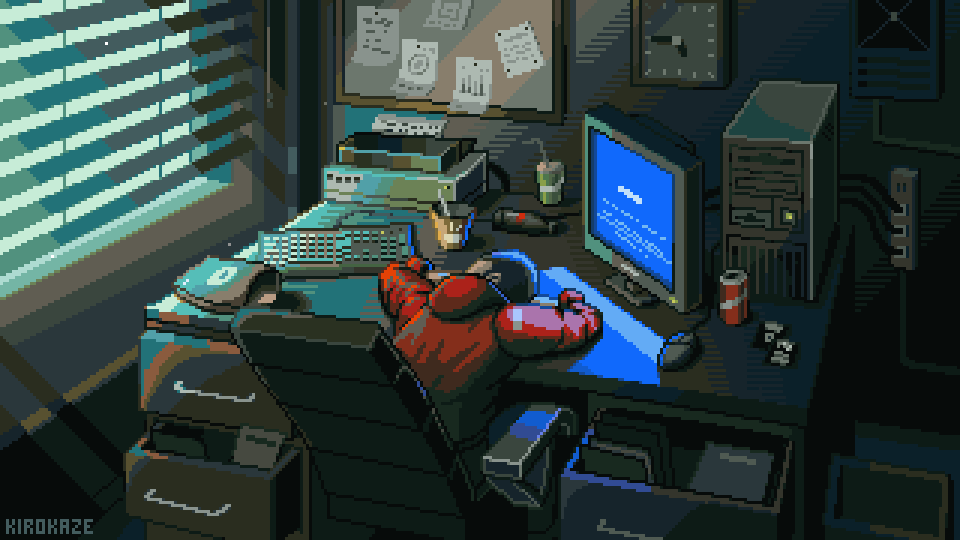

  
    
  <h1>
    Hi, I'm Fachril Akbar 
  </h1>
  <h3>Full-Stack Developer & AI/ML Enthusiast</h3>

 

<table border="0" cellpadding="0" cellspacing="0" width="100%">
  <tr>
    <td width="65%" valign="top">
      
I am an Informatics Engineering graduate focused on building functional web applications and exploring artificial intelligence. My technical background includes developing scalable full-stack systems and implementing computer vision models for image processing and real-time detection tasks.

      
I prioritize writing clean, maintainable code and continuously learning new tools to solve practical problems effectively.

      

        
      

      <ul>
        <li>Focusing on: <b>Full-Stack Web (Laravel, Next.js) & Deep Learning</b></li>
        <li>Reach me at: <b>fachrilakbar04@gmail.com</b></li>
      </ul>
    </td>
    <td width="35%" align="center" valign="top">
      
        
      <b>Connect with me:</b> 
      
      
    </td>
  </tr>
</table>

 

---

 

<h3 align="center"> Languages & Tools</h3>

   
  

 

<h3 align="center"> GitHub Statistics</h3>

<table width="100%">
  <tr>
    <td width="50%" valign="top" align="center">
      
    </td>
    <td width="50%" valign="top" align="center">
      
    </td>
  </tr>
</table>

  

 

<h3 align="center">🚀 Tech Stack</h3>

  
  
  
  
  
  
   

  
  
  
   

  
  
  
  
   

  
  
  
  
  

 

<h3 align="center">🐍 Contribution Graph</h3>

  <picture>
    <source media="(prefers-color-scheme: dark)" srcset="https://raw.githubusercontent.com/fachrilakbar12/fachrilakbar12/output/github-snake-dark.svg">
    <source media="(prefers-color-scheme: light)" srcset="https://raw.githubusercontent.com/fachrilakbar12/fachrilakbar12/output/github-snake.svg">
    
  </picture>

